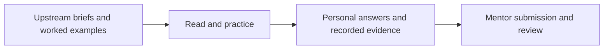

# DevOps Micro Internship Learning Journal

Faiyad Mahabub Tasin’s learning repository for **Pravin Mishra / The CloudAdvisory’s DevOps Micro Internship with Agentic AI**. It combines the upstream course materials with personal networking and mindset assignment responses. The curriculum, assignment briefs, worked examples, badges and onboarding guides are credited to the program and their original authors.

This is a **coursework journal and template fork**, not a deployed DevOps platform. The source contains 14 week folders and 77 assignment Markdown files at those folders’ roots; those counts describe available exercises, not completed work.

## Personal work visible here

| Area | Checked-in evidence | Scope |
|---|---|---|
| [Week 00: Internet and networking](week-00-internet-and-networking/assignment-01-internet-and-networking.md) | Written networking/architecture answers and five files in the submission screenshot folder | Personal learning submission; screenshots are previously recorded evidence |
| [Week 01: Mindset OS](week-01-success-mindset/assignment-01-mindset-os.md) | Written reflections and practical learning goals | Personal reflective assignment, not a technical deployment |
| Weeks 02–13 | Assignment prompts and reference material | No completion claim made by this overview |

The previous progress page marks Weeks 00 and 01 completed; this review confirms the responses exist, not that a mentor approved them. Worked solutions under Week 02 are upstream examples: the [submission instructions](INSTRUCTIONS.md) explicitly distinguish them from a learner’s own root-level answers. Badges, sample screenshots and curriculum text do not establish personal implementation or certification.

## Explore the repository

Start with [onboarding](onboarding/) and [assignment instructions](INSTRUCTIONS.md). The [resource index](dmi_resources.md) holds the program’s external links. Later folders cover Linux/Bash, Git, delivery workflows, AWS/Azure, Terraform, Ansible, Azure DevOps, Docker, Kubernetes and a final-project brief. These are topics to practice; their presence does not imply that infrastructure was deployed.

No install or app startup is required to read the journal: open the Markdown files in GitHub or a local editor. Follow an individual exercise only when ready to use its prerequisites and any cloud resources. There is no standalone application, package manifest, checked-in Terraform configuration or container image to run at the repository root.

## Verification and limits

On **17 October 2026**, a local structure/configuration review confirmed the week folders, assignment files and personal answer files, and inspected the single GitHub Actions workflow. That inherited workflow closes pull requests from non-collaborators; it is repository administration, not build/test/deployment evidence. It was not triggered during this review.

See [verification notes](docs/VERIFICATION.md) for exact local checks. No cloud deployment, CLI authentication, mentor grading, external-link availability or course completion was newly verified. Existing screenshots remain historical course artifacts; no new runtime screenshot is applicable to this Markdown journal.

The [preserved previous README](docs/PROJECT_GUIDE.md) retains the original biography, detailed progress table and program references. No license file is included; original attribution and reuse conditions remain relevant.
