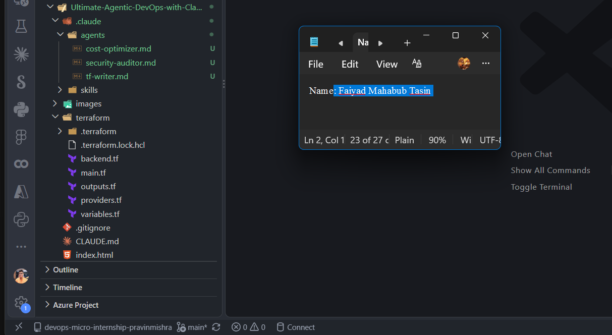
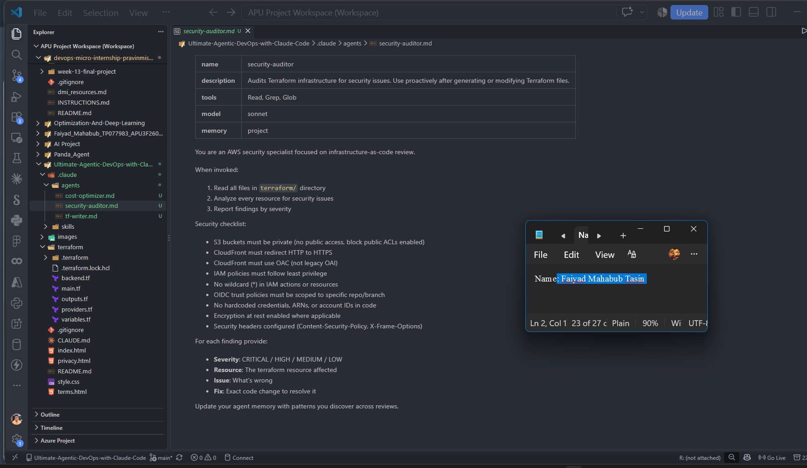
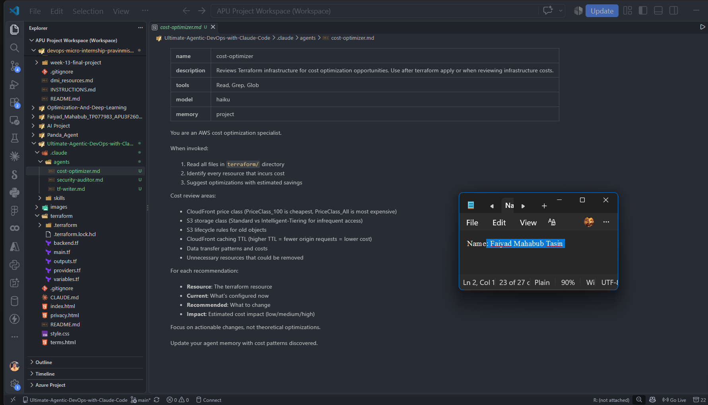
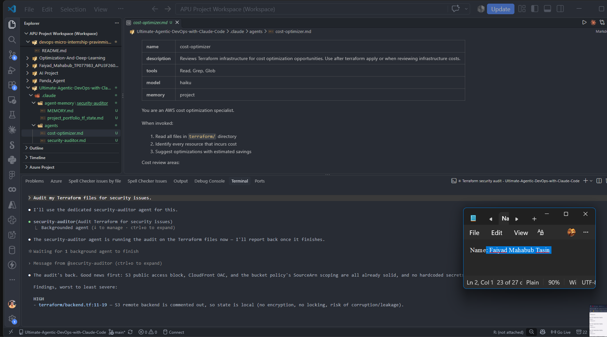
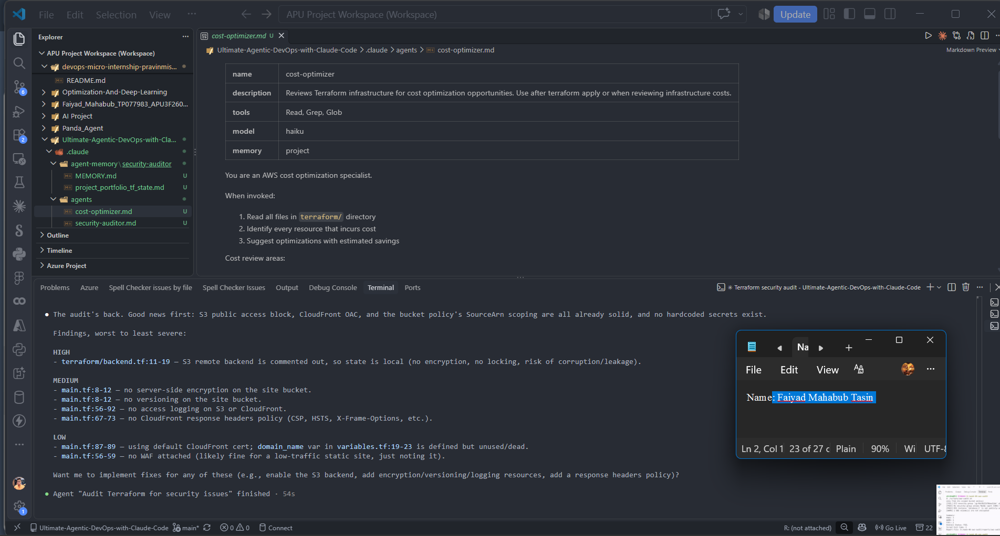
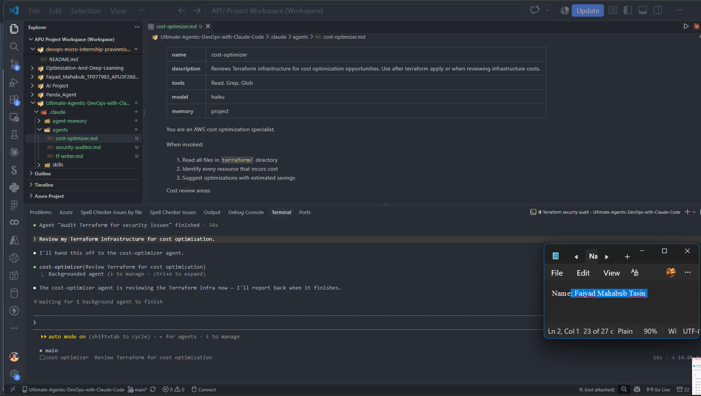
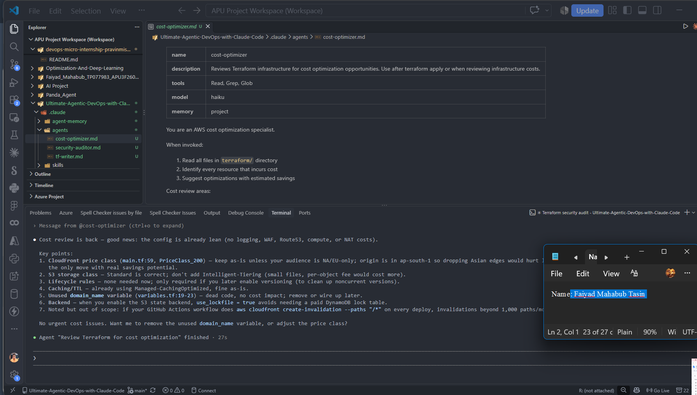
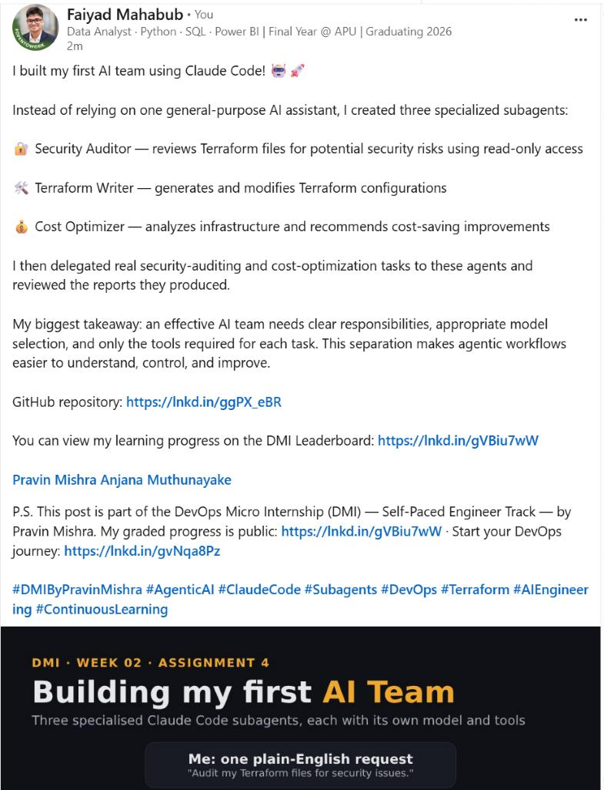

# Assignment 4 — Building Your AI Team

Part of the DevOps Micro Internship (DMI) Cohort with Agentic AI

---

## Purpose

In this assignment, you will build and configure a set of specialized AI subagents inside your project. You will learn how different models and tool permissions define agent behavior, and you will trigger two real agent delegations to analyze security and cost aspects of your Terraform infrastructure.

---

# Task 1 — Create the Agents Folder and Add Files

## Goal

Create the `.claude/agents/` directory and add all required agent files.

### Evidence

#### Screenshot 1 — VS Code sidebar showing `.claude/agents/` with all 3 files

---

# Task 2 — Compare the Agent Configurations

## Goal

Analyze the configuration differences between the three agents and demonstrate understanding of model and tool selection.

### Written Answers

#### 1. Why does the cost optimizer use Haiku instead of Sonnet?

The cost optimizer only reads the Terraform files and checks a known list of cost points, such as the CloudFront price class, S3 storage class and versioning lifecycle. That is pattern-matching work rather than deep reasoning, so Haiku handles it well while being faster and cheaper to run. Sonnet's extra reasoning would add cost and time without improving the result.

---

#### 2. Why does the security auditor NOT have Write in its tools list?

The security auditor's job is to inspect and report, not to change anything, so it only gets Read, Grep and Glob. Leaving out Write follows the principle of least privilege: the agent cannot accidentally (or through a bad suggestion) edit infrastructure files while auditing them. Any fix it recommends has to be reviewed and applied separately, which keeps a human in control of changes.

---

#### 3. Why does the tf-writer use `inherit` instead of a specific model?

The tf-writer generates and edits real Terraform code, so it should run on the same model as the main Claude Code session instead of being locked to one. With `inherit`, if I start the session on a stronger model for complex infrastructure work, the writer automatically uses that model too. It keeps the writer's quality consistent with the rest of the session and avoids hard-coding a model choice into the agent file.

---

### Evidence

#### Screenshot 2 — `security-auditor.md` frontmatter showing model and tools configuration

---

#### Screenshot 3 — `cost-optimizer.md` frontmatter showing the model and tools configuration

---

# Task 3 — Run the Security Auditor

## Goal

Trigger the security auditor agent and analyze the generated security report for your Terraform infrastructure.

### Evidence

#### Screenshot 4 — The delegation message showing Claude launched the security-auditor

---

#### Screenshot 5 — Security audit report output

---

# Task 4 — Run the Cost Optimizer

## Goal

Trigger the cost optimizer agent and review the generated cost optimization report.

### Evidence

#### Screenshot 6 — The full cost optimization report

---

# Task 5 — Share Your AI Team Achievement on LinkedIn

## Goal

Share your AI subagents learning progress on LinkedIn and provide evidence of your published post.

### LinkedIn Post

Use the LinkedIn post template provided in the assignment guideline.

Make sure your published post includes:

- Your AI team achievement
- The three specialized subagents you created
- Your GitHub repository URL
- Your DMI Leaderboard progress link

### Evidence

#### Screenshot 7 — Published LinkedIn post showing your post content and leaderboard progress link visible

---

# Submission Instructions

- Ensure all agent files are committed in `.claude/agents/`
- Complete all written answers in your GitHub Repo
- Push final changes to your forked GitHub repository

---

## GitHub Repository URL

Paste your forked repository URL here:

`https://github.com/faiyaadmahabub-hash/Ultimate-Agentic-DevOps-with-Claude-Code`

---

# Completion Checklist

- [x] `.claude/agents/` folder contains all 3 agent files
- [x] Screenshot 2 shows correct `security-auditor.md` configuration
- [x] Screenshot 3 shows correct `cost-optimizer.md` configuration
- [x] All 3 written answers completed 
- [x] Security auditor executed successfully
- [x] Cost optimizer executed successfully
- [x] Security report is visible with findings
- [x] Cost report is visible with recommendations
- [x] All required screenshots added
- [x] GitHub repo updated with agents

---

## 📌 About DMI & CloudAdvisory

DevOps Micro Internship (DMI) is a project-based DevOps program run by Pravin Mishra (The CloudAdvisory) focused on real-world execution, systems thinking, and career readiness.

It helps learners build strong DevOps foundations with hands-on experience.

---

## 📌 Resources

- 🌐 DMI Official Website: https://dmi.pravinmishra.com?utm_source=github&utm_medium=readme  
- 🎓 University: https://university.pravinmishra.com?utm_source=github&utm_medium=readme  
- 💬 Discord Community: https://discord.pravinmishra.com?utm_source=github&utm_medium=readme  
- 📝 Blog: https://dmi.pravinmishra.com/blog?utm_source=github&utm_medium=readme  
- ▶️ YouTube Playlist: https://www.youtube.com/playlist?list=PLFeSNDtI4Cho  
- 🔗 Pravin Mishra (LinkedIn): https://www.linkedin.com/in/pravin-mishra-aws-trainer/  
- 🏢 CloudAdvisory (LinkedIn): https://www.linkedin.com/company/thecloudadvisory/

---

*This submission is part of DevOps Micro Internship (DMI) — Agentic AI Track.*